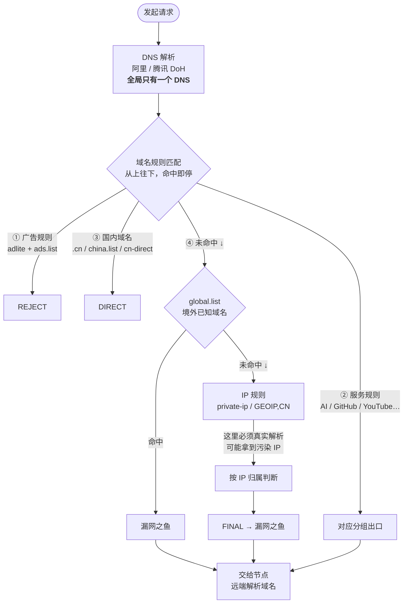
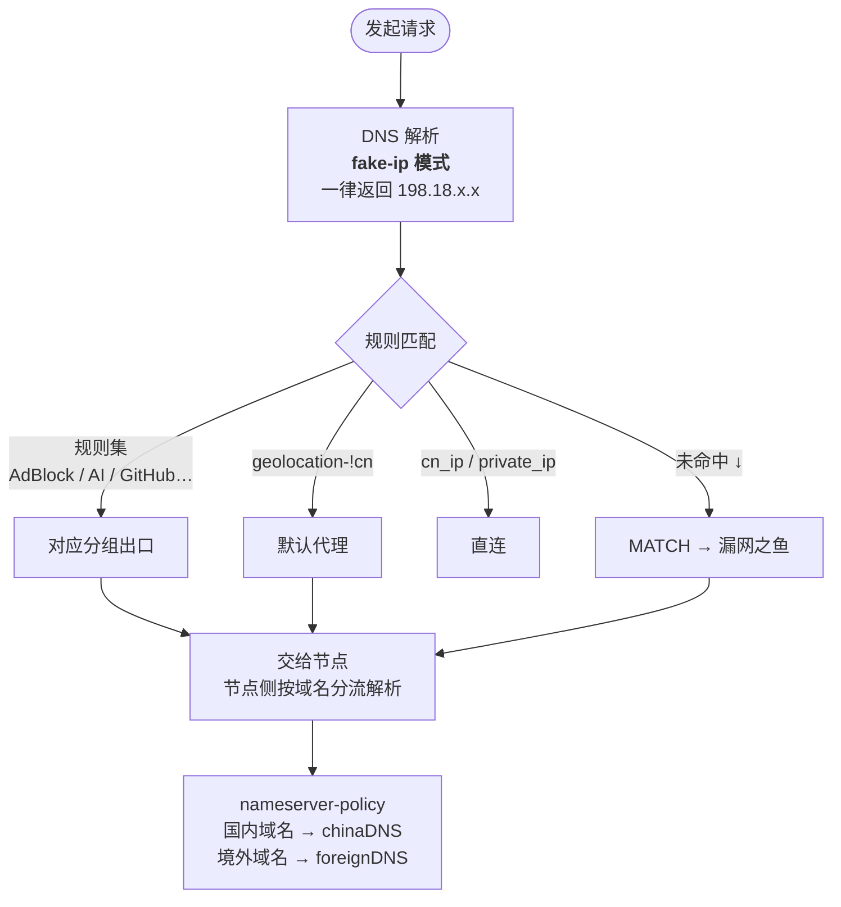
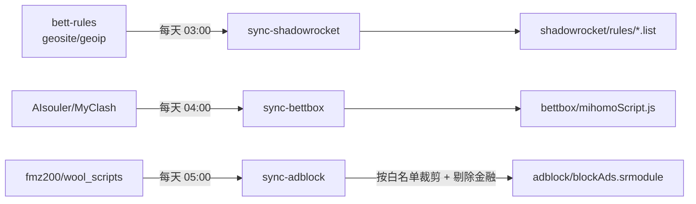

# sr-rules

一套自建的代理规则仓库，管三件事：

| 产物 | 给谁用 | 解决什么 |
| --- | --- | --- |
| [小火箭配置](shadowrocket/config.conf) | iPhone | 分流 + 去广告 |
| [Bettbox 脚本](bettbox/mihomoScript.js) | Windows | 分流 |
| [去广告模块](adblock/blockAds.srmodule) | iPhone | App 内开屏广告（可选，会变卡） |

全部每天自动跟随上游更新，你不用管。

---

## 🚀 三分钟上手

### iPhone（小火箭）

```
第 1 步  下配置
        小火箭 → 配置 → 右上角 + → 粘贴上面的配置地址 → 下载

第 2 步  开代理
        首页 → 打开开关

去广告已内置在配置里（DNS 规则，零解密），不需要装证书和模块。
只有想去掉 App 内开屏广告时，才需要装证书 + blockAds.srmodule，并把 [MITM] enable 改为 true。
```

### Windows（Bettbox）

```
覆写 / 脚本设置 → 填脚本地址 → 更新 → 重连
```

### 四条地址

```
配置      https://raw.githubusercontent.com/chaojiman/sr-rules/main/shadowrocket/config.conf
脚本      https://raw.githubusercontent.com/chaojiman/sr-rules/main/bettbox/mihomoScript.js
模块      https://raw.githubusercontent.com/chaojiman/sr-rules/main/adblock/blockAds.srmodule
模块-DNS  https://raw.githubusercontent.com/chaojiman/sr-rules/main/adblock/blockAds-dns.srmodule
```

> 模块-DNS 的规则已并入配置（`ads.list` + `ads-extra.list`），**不用再装**。完整版模块仍可选装，见下文「两个模块」。

> 大陆拉不动 raw.githubusercontent.com 时，把 `https://raw.githubusercontent.com/chaojiman/sr-rules/main/`
> 换成 `https://cdn.jsdelivr.net/gh/chaojiman/sr-rules@main/`

### 更新后检查（两个客户端通用）

```
小火箭   配置 → 点当前配置右侧 ⓘ → 更新 → 回首页确认代理已开启
Bettbox  覆写 / 脚本 → 更新 → 重连（或重启内核）
```

更新后只需确认三件事：

| 检查项 | 预期 |
| --- | --- |
| 默认出口 | YouTube / TikTok = 默认代理，AI = 美国，PayPal = 直连 |
| 广告拦截 | 小火箭的「广告拦截」组为 `REJECT`；Bettbox 的 `AdBlock` 组为 `REJECT` |
| 多余分组 | Bettbox 不应再出现 Line / Emby / PikPak / Spotify / Crypto / PayPal / Patreon / EHentai |

> Bettbox 会记住你之前手动选过的出口，新默认值不一定能覆盖旧选择。上表对不上时手动点一下即可。
> 从 URL 更新小火箭配置会重置为 `policy-select-name` 的默认值。

---

## 🔀 请求是怎么走的

这是两个客户端最核心的区别，也是同一份规则在小火箭上偶尔会「打不开」而 Bettbox 不会的原因。

### 小火箭



**关键点**：只有走到 ④ 和 ⑤ 才需要真实 IP。① ② ③ 全靠域名匹配，零解析、零污染风险。

### Bettbox / Clash



**关键点**：本地 DNS **永远返回假 IP**，不存在污染问题。真正解析发生在节点侧，并按域名自动选对 DNS。

### 一眼看懂差别

| | 小火箭 | Bettbox |
| --- | --- | --- |
| 本地 DNS 用途 | 真解析，结果参与分流判断 | 只发假 IP，不参与连接 |
| DNS 服务器数量 | **全局一个**，无法按域名切换 | 按域名策略自动选（`nameserver-policy`） |
| 境外域名解析 | 国内 DoH → **可能污染** | 节点侧解析 → 干净 |
| 防污染手段 | 靠规则顺序把域名挡在解析之前 | 架构层面免疫 |
| 出问题的表现 | Load failed / 莫名走错出口 | 基本不会 |

### 为什么小火箭要靠「规则顺序」兜底

实测国内 DoH 对境外域名的解析结果：

| 域名 | 阿里 DoH | 腾讯 DoH | 真实 IP |
| --- | --- | --- | --- |
| www.okx.com | `169.254.0.2` | `169.254.0.2` | 104.18.43.174 |
| www.google.com | `69.171.235.22` | 142.251.156.119 | 142.251.157.119 |
| coinbase.com | `31.13.96.192` | `199.59.148.6` | 104.18.35.15 |
| www.binance.com | `208.101.60.87` | `199.16.158.104` | 13.35.190.32 |

`169.254.x.x` 不可路由，`31.13.x.x` 是 Facebook 网段 —— 全是污染。

小火箭无法避免解析，只能**让尽可能多的域名在解析之前就分流完毕**。这就是 `global.list`（66,969 条境外域名）必须放在 IP 规则前面的原因。

---

## 📱 小火箭

### 规则顺序（36 条）

```
1    广告拦截      adlite + ads + ads-extra（含原 DNS 版模块）
1.5  显式优先      snssdk 直连、muse.ai、okx
2    GitHub → AI   github → ai → ai-extra（OpenAI + Gemini）
3    流媒体        YouTube
4    社交          Telegram → TikTok
5    支付          PayPal
6    开发云        OneDrive → 微软 → 谷歌 → 苹果
7    游戏          steam → games（SteamCN/Epic/Nintendo/Sony/Game 合并）
8    国内直连      .cn → bilibili → douyin → cn-direct
9    兜底          china → private → global(境外) → private-ip
                   → GEOIP,CN → FINAL(漏网之鱼)
```

**每个域名独立从上往下扫，命中第一条即停。**

顺序不能随便改，几个必须遵守的约束：

| 约束 | 原因 |
| --- | --- |
| 广告在最前 | 否则被后面的服务规则抢走 |
| GitHub 在 AI 前 | Copilot 域名同时在 AI 规则集里 |
| AI 在谷歌前 | `*.googleapis.com` 上的 Gemini 会被谷歌抢走 |
| OneDrive 在微软前 | 微软规则集包含 OneDrive 域名 |
| `.cn` 在国内段最前 | 企业站/地方站兜底 |
| `global` 在 IP 规则前 | 避免触发 DNS 解析（见上一节） |

### 分组默认出口

| 分组 | 默认 | 分组 | 默认 |
| --- | --- | --- | --- |
| AI | 美国节点 | PayPal | DIRECT |
| YouTube | PROXY（默认代理） | 微软服务 | PROXY |
| GitHub / 谷歌 / Telegram | PROXY | 苹果服务 | DIRECT |
| TikTok | PROXY | 游戏平台 / 哔哩哔哩 | DIRECT |
| Netflix / Disney+ / Max / Spotify / Facebook / Amazon | 无独立分组，走漏网之鱼 | | |
| 地区组（6 个） | 手动选择，不自动切换 | 漏网之鱼 | PROXY |
| | | 广告拦截 | REJECT |

> 地区组是纯手动，选谁就是谁，不会自己跳。想改默认值就改 `config.conf` 里的 `policy-select-name`。

### 去广告

分两层，互相独立：

| 层 | 手段 | 风险 | 拦什么 |
| --- | --- | --- | --- |
| 1 | DNS 规则（adlite 5.3 万域名 + ads.list 3.2 千条 + ads-extra 85 条） | 零 | 独立广告域名、广告 SDK |
| 2 | MITM 模块 | 低 | App 内信息流、开屏、弹窗 |

### 两个模块

| 模块 | 内容 | 性能 | 能拦什么 |
| --- | --- | --- | --- |
| [blockAds-dns.srmodule](adblock/blockAds-dns.srmodule) | 只有 `[Rule]` 段（2,950 条 REJECT），**无 MITM、无脚本** | **零开销**，等同于没装模块 | 独立广告域名、广告 SDK |
| [blockAds.srmodule](adblock/blockAds.srmodule) | `[Rule]` + MITM 191 域名 + 94 条脚本 + 209 条 Map Local | **有开销**：命中域名要解密 + 缓冲整个响应体 + 跑 JS | 上面全部 + App 内开屏 / 信息流 / 弹窗 |

**iOS 上打开网页明显变卡时，换 `-dns` 版。** 实测：完整版对 `www.baidu.com`、`www.zhihu.com`、
`edith.xiaohongshu.com`、`mp.weixin.qq.com` 这类日常高频站做解密 + `requires-body` 缓冲，
是卡顿主因；`-dns` 版没有任何解密，体验和装模块前完全一致。

> `-dns` 版的规则每天会并进配置，**不需要再装**；装了只会让每个请求多过一遍重复规则。

**模块是裁剪过的**：上游 `fmz200/wool_scripts` 对 900+ 个域名开 HTTPS 解密，覆盖 700 款 App，范围越大越容易卡顿、误伤。本仓库每天自动裁剪：

| 部分 | 处理 |
| --- | --- |
| `[Rule]` DNS 拦截 | 全部保留（零风险），只剔金融段 |
| 解密规则（Rewrite / Map Local / Script） | 只保留 [`adblock/keep-apps.txt`](adblock/keep-apps.txt) 白名单里的 App |
| `[MITM] hostname` | 只保留白名单 App 的域名，金融关键词兜底过滤 |
| 金融类 App | 全部剔除（证书固定，解密即断网）；雪球/同花顺/天天基金例外。**段名要命中 `FIN_SECTION` 关键词**，`云闪付` 这种不含金融字样的段名需显式补进正则 |
| 脚本超时 | 普通 10s，protobuf（binary-body-mode）20s，上游原为 60s |
| QUIC | 抖音/淘宝/闲鱼/知乎/拼多多/B 站直连 QUIC 单独拦截，迫使走 TCP 才能去开屏 |

**新 App 想去广告**：在上游模块里搜 `# > App名`，把段名原样加进 `keep-apps.txt` 并提交，CI 自动重建。

配置里还有第二重保险：

```ini
[MITM]
hostname = -*.ccb.com,-*.icbc.com.cn,-*.pingan.com.cn,...   # 58 条金融域名负向排除
```

即使以后误装了别的模块，这些域名也永远不会被解密。

> ⚠️ **模块 `[Rule]` 优先于 `config.conf`**（与配置内的顺序无关）。模块里的 `REJECT` 会盖掉配置里的 `DIRECT`，
> 所以在 `config.conf` 里补一条 `DOMAIN-SUFFIX,xxx,DIRECT` **救不了**被模块误伤的域名 —— 只能改构建脚本
> 或关掉模块。
>
> 已踩过：`# > 云闪付` 段的 `switch.cup.com.cn`（活动开关下发）、`tysdk.95516.com`、`ads.cup.com.cn`
> 被 REJECT，云闪付活动区空白。该段名不含「银联 / 支付」等关键词，金融剔除逻辑没拦住，
> 而 `[Rule]` 是「全部保留」，于是整段生效。

**出问题怎么回滚**：

| 症状 | 处理 |
| --- | --- |
| 某个 App 异常 | `[MITM] hostname` 加 `,-*.该域名` |
| 整体不对劲 | `[MITM] enable = false`，立刻恢复原状 |

### 主 API 风险与检测

模块最容易出问题的地方：**对 App 的主 API 做 MITM**，并让版本检查、配置下发这类接口返回 `{}`，App 会直接不可用或明显卡顿。

已经踩过两次：

| App | 域名 | 症状 | 处理 |
| --- | --- | --- | --- |
| 京东 | `api.m.jd.com` | 浏览/搜索卡顿 | 移出 MITM |
| 山姆 | `api-sams.walmartmobile.cn` | 完全无法访问 | 移出 MITM |

每次构建后自动跑一次扫描：

```bash
node scripts/check-adblock-risk.mjs
```

输出分级清单：

```
🔴 高危   主 API + 版本/登录/启动接口   → 最可能导致 App 不可用
🟡 中危   主 API + config/init/home 类
⚪ 其余   主 API + 纯广告位
```

规则还在但域名已移出 MITM 的，标记为「已豁免」，不参与统计。

**新增豁免**：在 `scripts/build-adblock.mjs` 的 `DOMAIN_PATTERNS` 里加一行正则即可。

---

## 💻 Bettbox

在「覆写 / 脚本」里填脚本地址即可，其余交给脚本。

### 相对上游 MyClash 的改动

| 改动 | 内容 |
| --- | --- |
| 规则顺序 | 国内基础直连 → `AdBlock → GitHub → AI → .cn → YouTube → Google → …` |
| GitHub 提前 | Copilot 全系自然归 GitHub，不用逐条钉 |
| AI 提前 | `antigravity` / `gemini` 的 `*.googleapis.com` 不被谷歌抢 |
| `.cn` 兜底 | 放在 AdBlock / GitHub / AI 后，避免 `.cn` 广告域名被提前直连；覆盖企业站/地方站 |
| 默认开关 | 基础三组 / FCM / Twitter / 倍率组 / 家宽组关闭；地区自动选择组、屏蔽代理 QUIC、IPv4 优先开启 |
| 服务默认出口 | YouTube / TikTok = 默认代理，AI = 美国（与小火箭一致） |

### 分组一览

生成后的策略组数量取决于订阅里出现哪些地区（地区组按节点名自动生成）。

每个地区会生成**两个**组：

| 组名 | 类型 | 作用 |
| --- | --- | --- |
| `香港-自动选择` | url-test | 同地区内自动挑延迟最低的节点 |
| `香港` | select | 手动选择；选项里包含上面那个自动组 |

> 自动组默认 `hidden`，只在手动组的选项里出现，不会单独占一行。
> 其他地区（日本 / 美国 / 台湾 / 新加坡 / 韩国）同理，没有节点时不生成。

**保留独立分组的服务**（可在 Bettbox 界面直接切换出口）：

| 分组 | 默认出口 | 可选 |
| --- | --- | --- |
| YouTube | 默认代理 | 默认代理 / 各地区 / 节点 |
| Google | 默认代理 | 同上 |
| AI | 美国 | 同上 |
| GitHub | 默认代理 | 同上 |
| Telegram | 默认代理 | 同上 |
| TikTok | 默认代理 | 同上 |
| Meta | 默认代理 | 同上 |
| Netflix | 默认代理 | 同上 |
| Microsoft / Apple / Steam | 默认代理 | 同上 + 直连 |
| AdBlock | REJECT | REJECT / REJECT-DROP / PASS |
| 漏网之鱼 | 默认代理 | 默认代理 / 直连 / 各地区 |

**不再生成分组的服务**（不会出现在 Bettbox 策略组列表里）：

| 服务 | 规则是否保留 | 实际出口 |
| --- | --- | --- |
| Line / PikPak / Spotify / Crypto / Patreon / EHentai | **不保留**，连规则源一起删除 | 由 `geolocation-!cn` 或 `MATCH` 兜底 → 默认代理 |
| Emby / PayPal | **保留**，但规则直接指向 `直连` | 直连 |

> 为什么默认代理的服务可以删规则：Bettbox 末尾是 `geolocation-!cn → 默认代理`、`MATCH → 漏网之鱼`（默认也是默认代理）。
> 这些服务不删规则最终也是同一个出口，删掉只是少一次匹配和少下载几个规则源。
>
> Emby / PayPal 不能删：它们需要**直连**，删掉就会被兜底送去代理。

这些服务的开关同时被设为 `false`，并且从 `Compatible_With_Bettbox.policyGroupOptions` 中移除，
所以即使 Bettbox 界面保存过旧开关，也不会重新长回这些分组。

### 加临时规则

编辑 [`bettbox/rules-extra.txt`](bettbox/rules-extra.txt)，一行一条，改动会被注入到规则最前面：

```
DOMAIN-SUFFIX,example.com,美国
PROCESS-PATH-REGEX,(?i)\\antigravity\\,AI
```

改完推上去 → Action 几分钟内重建 → Bettbox 重连生效。

> 进程类规则（`PROCESS-NAME` / `PROCESS-PATH-REGEX`）需要 Bettbox 界面「查找进程」打开。
> 系统代理模式下 Antigravity 的 `language_server.exe` 不读系统代理，用 [`bettbox/Antigravity-proxy.cmd`](bettbox/Antigravity-proxy.cmd) 启动。

---

## 🔄 自动更新

三条独立流水线，每天各跑一次：



改 A 不影响 B、C。

| 变更 | 生效方式 |
| --- | --- |
| 上游规则变化 | 次日自动，小火箭需手动点「更新」 |
| 上游脚本变化 | 次日自动，Bettbox 重连生效 |
| 改 `rules-extra.txt` | 几分钟内，Bettbox 重连生效 |
| 改 `config.conf` | 会触发校验与规则重建，但**手机仍需手动点「更新」**才能拿到新配置 |
| 改 `build-bettbox.mjs` | 会重新生成 `mihomoScript.js`，Bettbox 点「更新」后生效 |

---

## 🔧 维护

| 想改什么 | 改哪 |
| --- | --- |
| 分流规则 / 分组 | `shadowrocket/config.conf` |
| Bettbox 临时规则 | `bettbox/rules-extra.txt` |
| 规则集分类增删 | `scripts/build-shadowrocket.mjs` 的 `GEOSITE` |
| Bettbox 补丁 | `scripts/build-bettbox.mjs` 的 `REPLACES` |
| 去广告 App 白名单 | `adblock/keep-apps.txt` |
| 去广告金融剔除 / QUIC 拦截 | `scripts/build-adblock.mjs` 的 `FIN_SECTION` / `QUIC_BLOCK` |

本地生成：

```bash
node scripts/build-shadowrocket.mjs          # 全量规则集
node scripts/build-shadowrocket.mjs ai china # 指定分类
node scripts/build-bettbox.mjs               # Bettbox 脚本
node scripts/build-bettbox.mjs --check       # 只校验锚点
node scripts/validate-configs.mjs             # 校验生成结果、规则顺序和引用
node scripts/build-adblock.mjs               # 去广告模块
node scripts/check-adblock-risk.mjs          # 扫描模块里的高危规则
node scripts/audit-adblock.mjs               # 审计模块引用的外部脚本
```

---

## ❓ 常见问题

**Q：更新配置后分组选择全没了？**
A：从 URL 更新会重置为 `policy-select-name` 的默认值，重新点一遍即可。

**Q：某个网站打不开，换节点也没用？**
A：先查 DNS。`curl -sS -H "accept: application/dns-json" "https://223.5.5.5/resolve?name=域名&type=A"`，如果返回 `169.254.x.x` 就是污染，在 `[Rule]` 的 1.5 段加一条 `DOMAIN-SUFFIX,域名,漏网之鱼`。

**Q：广告还有怎么办？**
A：先清 App 缓存或重装（模块效果缓存在 App 内）。仍不行就是没覆盖，反馈 App 名。

**Q：装模块后银行 App 会不会出问题？**
A：不会。银行域名从未进入解密流程，构建时也已剔除。真出问题就把 `[MITM] enable` 改回 `false`。

**Q：能只去广告不代理吗？**
A：不能。去广告模块依赖 MITM，而 MITM 需要代理接管流量。

---

## 📐 转换规则

| 源格式 | 输出 | 原因 |
| --- | --- | --- |
| geosite `+.example.com` | `example.com` + `.example.com` 两行 | DOMAIN-SET 不认 `+.` 前缀 |
| geoip `1.0.1.0/24` | `IP-CIDR,1.0.1.0/24` | **不加** `no-resolve`：加了 IP 规则对域名请求直接跳过，兜底失效 |
| 第三方规则集 `USER-AGENT` / `IP-ASN` | 当前保留；IP 类规则加 `no-resolve`，由校验脚本检查类型 | 当前生成文件已包含这两类规则；真机兼容性待逐项确认，不再宣称构建时一律丢弃 |
| `ADLite.list`（RULE-SET 5.3 万条 `DOMAIN-SUFFIX`） | 本地 `adlite.list`（DOMAIN-SET 10.6 万行） | 域名集合查表比逐条规则匹配快；128 条 IP-CIDR 与 `GEOIP,CN` 重叠，丢弃 |
| 被前序规则遮蔽的域名 | 构建时剔除 | 小火箭命中即停，这些条目永远不会生效（实测占 35.7%），白占内存 |

---

## 📜 数据来源

- 规则内容：[appshubcc/bett-rules](https://github.com/appshubcc/bett-rules)、[v2fly/domain-list-community](https://github.com/v2fly/domain-list-community)
- 补充规则集：ios_rule_script
- 去广告模块：[fmz200/wool_scripts](https://github.com/fmz200/wool_scripts)
- 覆写脚本：[AIsouler/MyClash](https://github.com/AIsouler/MyClash)

本仓库只做格式转换、顺序调整和按白名单裁剪，不主张规则内容的所有权。
