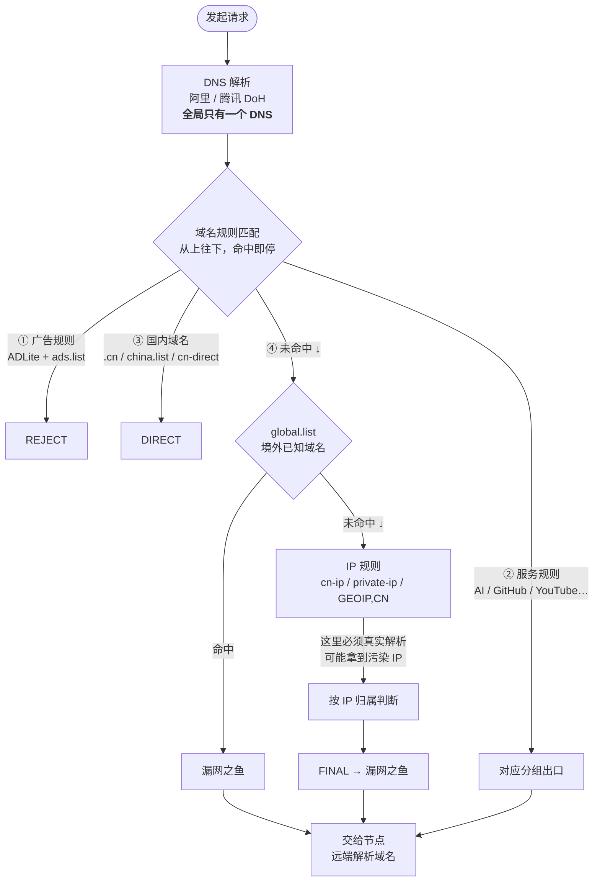
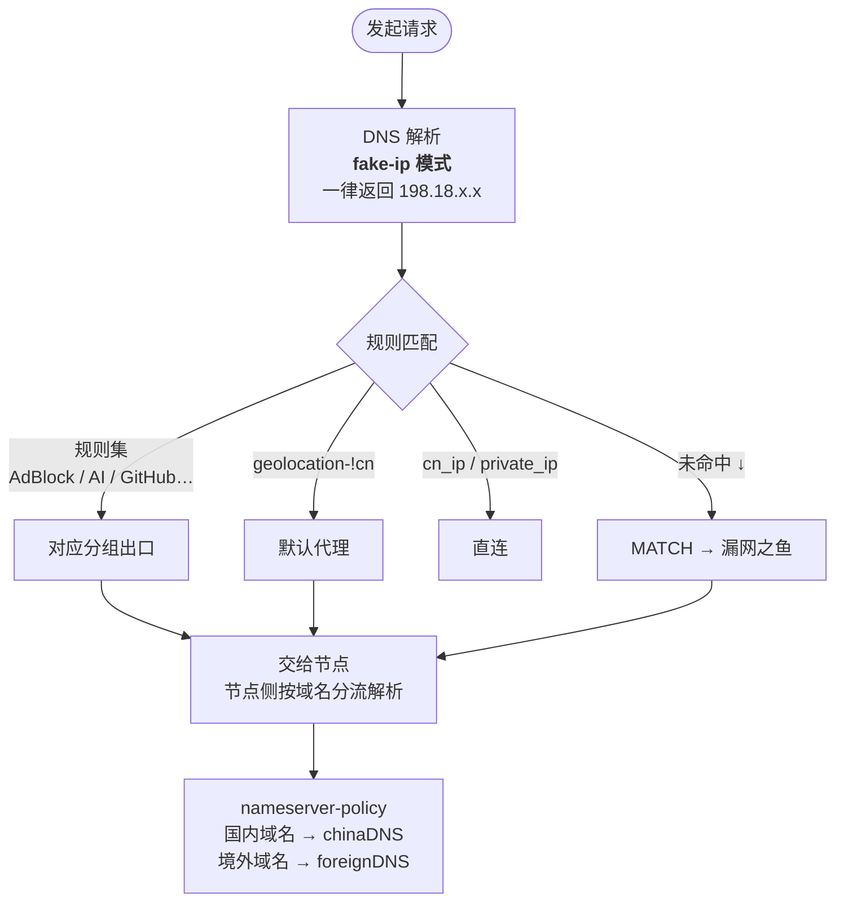
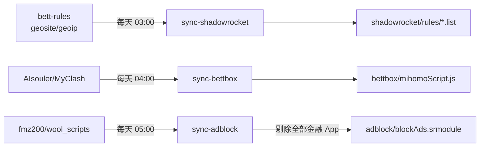

# sr-rules

一套自建的代理规则仓库，管三件事：

| 产物 | 给谁用 | 解决什么 |
| --- | --- | --- |
| [小火箭配置](shadowrocket/config.conf) | iPhone | 分流 + 去广告 |
| [Bettbox 脚本](bettbox/mihomoScript.js) | Windows | 分流 |
| [去广告模块](adblock/blockAds.srmodule) | iPhone | App 内广告 |

全部每天自动跟随上游更新，你不用管。

---

## 🚀 三分钟上手

### iPhone（小火箭）

```
第 1 步  下配置
        小火箭 → 配置 → 右上角 + → 粘贴上面的配置地址 → 下载

第 2 步  装证书（去广告才需要，只要做一次）
        配置后面的 ⓘ → HTTPS 解密 → 生成新的 CA 证书 → 安装
        iOS 设置 → 已下载描述文件 → 安装
        iOS 设置 → 通用 → 关于本机 → 证书信任设置 → 打开小火箭

第 3 步  装去广告模块
        小火箭 → 模块 → 右上角 + → 粘贴模块地址

第 4 步  开代理
        首页 → 打开开关
```

### Windows（Bettbox）

```
覆写 / 脚本设置 → 填脚本地址 → 更新 → 重连
```

### 三条地址

```
配置  https://raw.githubusercontent.com/chaojiman/sr-rules/main/shadowrocket/config.conf
脚本  https://raw.githubusercontent.com/chaojiman/sr-rules/main/bettbox/mihomoScript.js
模块  https://raw.githubusercontent.com/chaojiman/sr-rules/main/adblock/blockAds.srmodule
```

> 大陆拉不动 raw.githubusercontent.com 时，把 `https://raw.githubusercontent.com/chaojiman/sr-rules/main/`
> 换成 `https://cdn.jsdelivr.net/gh/chaojiman/sr-rules@main/`

---

## 🔀 请求是怎么走的

这是两个客户端最核心的区别，也是同一份规则在小火箭上偶尔会「打不开」而 Bettbox 不会的原因。

### 小火箭



**关键点**：只有走到 ④ 和 ⑤ 才需要真实 IP。① ② ③ 全靠域名匹配，零解析、零污染风险。

### Bettbox / Clash



**关键点**：本地 DNS **永远返回假 IP**，不存在污染问题。真正解析发生在节点侧，并按域名自动选对 DNS。

### 一眼看懂差别

| | 小火箭 | Bettbox |
| --- | --- | --- |
| 本地 DNS 用途 | 真解析，结果参与分流判断 | 只发假 IP，不参与连接 |
| DNS 服务器数量 | **全局一个**，无法按域名切换 | 按域名策略自动选（`nameserver-policy`） |
| 境外域名解析 | 国内 DoH → **可能污染** | 节点侧解析 → 干净 |
| 防污染手段 | 靠规则顺序把域名挡在解析之前 | 架构层面免疫 |
| 出问题的表现 | Load failed / 莫名走错出口 | 基本不会 |

### 为什么小火箭要靠「规则顺序」兜底

实测国内 DoH 对境外域名的解析结果：

| 域名 | 阿里 DoH | 腾讯 DoH | 真实 IP |
| --- | --- | --- | --- |
| www.okx.com | `169.254.0.2` | `169.254.0.2` | 104.18.43.174 |
| www.google.com | `69.171.235.22` | 142.251.156.119 | 142.251.157.119 |
| coinbase.com | `31.13.96.192` | `199.59.148.6` | 104.18.35.15 |
| www.binance.com | `208.101.60.87` | `199.16.158.104` | 13.35.190.32 |

`169.254.x.x` 不可路由，`31.13.x.x` 是 Facebook 网段 —— 全是污染。

小火箭无法避免解析，只能**让尽可能多的域名在解析之前就分流完毕**。这就是 `global.list`（66,969 条境外域名）必须放在 IP 规则前面的原因。

---

## 📱 小火箭

### 规则顺序（47 条）

```
1    广告拦截      ADLite + ads.list
1.5  显式优先      snssdk 直连、muse.ai、okx
2    GitHub → AI   github → ai → OpenAI → Gemini
3    流媒体        Netflix → Disney+ → Max → YouTube → Spotify
4    社交          Telegram → Facebook → TikTok
5    支付          PayPal → Amazon
6    开发云        OneDrive → 微软 → 谷歌 → 苹果
7    游戏          Steam → SteamCN → Epic → Nintendo → Sony → Game
8    国内直连      .cn → bilibili → douyin → cn-direct
9    兜底          china → private → global(境外) → cn-ip → private-ip
                   → GEOIP,CN → FINAL(漏网之鱼)
```

**每个域名独立从上往下扫，命中第一条即停。**

顺序不能随便改，几个必须遵守的约束：

| 约束 | 原因 |
| --- | --- |
| 广告在最前 | 否则被后面的服务规则抢走 |
| GitHub 在 AI 前 | Copilot 域名同时在 AI 规则集里 |
| AI 在谷歌前 | `*.googleapis.com` 上的 Gemini 会被谷歌抢走 |
| OneDrive 在微软前 | 微软规则集包含 OneDrive 域名 |
| `.cn` 在国内段最前 | 企业站/地方站兜底 |
| `global` 在 IP 规则前 | 避免触发 DNS 解析（见上一节） |

### 分组默认出口

| 分组 | 默认 | 分组 | 默认 |
| --- | --- | --- | --- |
| AI | 美国节点 | PayPal / Amazon | DIRECT |
| YouTube | 香港节点 | 微软服务 | PROXY |
| GitHub / 谷歌 / Telegram | PROXY | 苹果服务 | DIRECT |
| 其余服务组 | PROXY | 游戏平台 / 哔哩哔哩 | DIRECT |
| 地区组（6 个） | 手动选择，不自动切换 | 漏网之鱼 | PROXY |
| | | 广告拦截 | REJECT |

> 地区组是纯手动，选谁就是谁，不会自己跳。想改默认值就改 `config.conf` 里的 `policy-select-name`。

### 去广告

分两层，互相独立：

| 层 | 手段 | 风险 | 拦什么 |
| --- | --- | --- | --- |
| 1 | DNS 规则（ADLite 5 万条 + ads.list） | 零 | 独立广告域名、广告 SDK |
| 2 | MITM 模块 | 低 | App 内信息流、开屏、弹窗 |

**模块是裁剪过的**：上游 `fmz200/wool_scripts` 对 35 个银行域名开了 HTTPS 解密，这些 App 有证书固定，装了会直接无法联网。本仓库每天自动剔除全部金融类 App（银行/证券/基金/保险/钱包/支付），保留其余 686 款。

配置里还有第二重保险：

```ini
[MITM]
hostname = -*.ccb.com,-*.icbc.com.cn,-*.abchina.com,...   # 26 条金融域名负向排除
```

即使以后误装了别的模块，这些域名也永远不会被解密。

**出问题怎么回滚**：

| 症状 | 处理 |
| --- | --- |
| 某个 App 异常 | `[MITM] hostname` 加 `,-*.该域名` |
| 整体不对劲 | `[MITM] enable = false`，立刻恢复原状 |

---

## 💻 Bettbox

在「覆写 / 脚本」里填脚本地址即可，其余交给脚本。

### 相对上游 MyClash 的改动

| 改动 | 内容 |
| --- | --- |
| 规则顺序 | `AdBlock → GitHub → AI → FCM → YouTube → Google → …` |
| GitHub 提前 | Copilot 全系自然归 GitHub，不用逐条钉 |
| AI 提前 | `antigravity` / `gemini` 的 `*.googleapis.com` 不被谷歌抢 |
| `.cn` 兜底 | 补 `DOMAIN-SUFFIX,cn,直连`，覆盖企业站/地方站 |
| 默认开关 | 基础三组 / FCM / Twitter / 地区自动组 / 倍率组关闭，IPv4 优先开启 |

### 加临时规则

编辑 [`bettbox/rules-extra.txt`](bettbox/rules-extra.txt)，一行一条，改动会被注入到规则最前面：

```
DOMAIN-SUFFIX,example.com,美国
PROCESS-NAME,Antigravity.exe,AI
```

改完推上去 → Action 几分钟内重建 → Bettbox 重连生效。

---

## 🔄 自动更新

三条独立流水线，每天各跑一次：



改 A 不影响 B、C。

| 变更 | 生效方式 |
| --- | --- |
| 上游规则变化 | 次日自动，小火箭需手动点「更新」 |
| 上游脚本变化 | 次日自动，Bettbox 重连生效 |
| 改 `rules-extra.txt` | 几分钟内，Bettbox 重连生效 |
| 改 `config.conf` | **不自动**，手机要手动更新 |

---

## 🔧 维护

| 想改什么 | 改哪 |
| --- | --- |
| 分流规则 / 分组 | `shadowrocket/config.conf` |
| Bettbox 临时规则 | `bettbox/rules-extra.txt` |
| 规则集分类增删 | `scripts/build-shadowrocket.mjs` 的 `GEOSITE` |
| Bettbox 补丁 | `scripts/build-bettbox.mjs` 的 `REPLACES` |
| 去广告剔除范围 | `scripts/build-adblock.mjs` 的 `FIN_SECTION` |

本地生成：

```bash
node scripts/build-shadowrocket.mjs          # 全量规则集
node scripts/build-shadowrocket.mjs ai china # 指定分类
node scripts/build-bettbox.mjs               # Bettbox 脚本
node scripts/build-bettbox.mjs --check       # 只校验锚点
node scripts/build-adblock.mjs               # 去广告模块
node scripts/audit-adblock.mjs               # 审计模块引用的外部脚本
```

---

## ❓ 常见问题

**Q：更新配置后分组选择全没了？**
A：从 URL 更新会重置为 `policy-select-name` 的默认值，重新点一遍即可。

**Q：某个网站打不开，换节点也没用？**
A：先查 DNS。`curl -sS -H "accept: application/dns-json" "https://223.5.5.5/resolve?name=域名&type=A"`，如果返回 `169.254.x.x` 就是污染，在 `[Rule]` 的 1.5 段加一条 `DOMAIN-SUFFIX,域名,漏网之鱼`。

**Q：广告还有怎么办？**
A：先清 App 缓存或重装（模块效果缓存在 App 内）。仍不行就是没覆盖，反馈 App 名。

**Q：装模块后银行 App 会不会出问题？**
A：不会。银行域名从未进入解密流程，构建时也已剔除。真出问题就把 `[MITM] enable` 改回 `false`。

**Q：能只去广告不代理吗？**
A：不能。去广告模块依赖 MITM，而 MITM 需要代理接管流量。

---

## 📐 转换规则

| 源格式 | 输出 | 原因 |
| --- | --- | --- |
| geosite `+.example.com` | `example.com` + `.example.com` 两行 | DOMAIN-SET 不认 `+.` 前缀 |
| geoip `1.0.1.0/24` | `IP-CIDR,1.0.1.0/24` | **不加** `no-resolve`：加了 IP 规则对域名请求直接跳过，兜底失效 |
| 第三方规则集 `USER-AGENT` / `IP-ASN` | 丢弃 | 小火箭规则集不支持，混入会导致整条加载失败 |

---

## 📜 数据来源

- 规则内容：[appshubcc/bett-rules](https://github.com/appshubcc/bett-rules)、[v2fly/domain-list-community](https://github.com/v2fly/domain-list-community)
- 补充规则集：ios_rule_script
- 去广告模块：[fmz200/wool_scripts](https://github.com/fmz200/wool_scripts)
- 覆写脚本：[AIsouler/MyClash](https://github.com/AIsouler/MyClash)

本仓库只做格式转换、顺序调整和金融类剔除，不主张规则内容的所有权。
